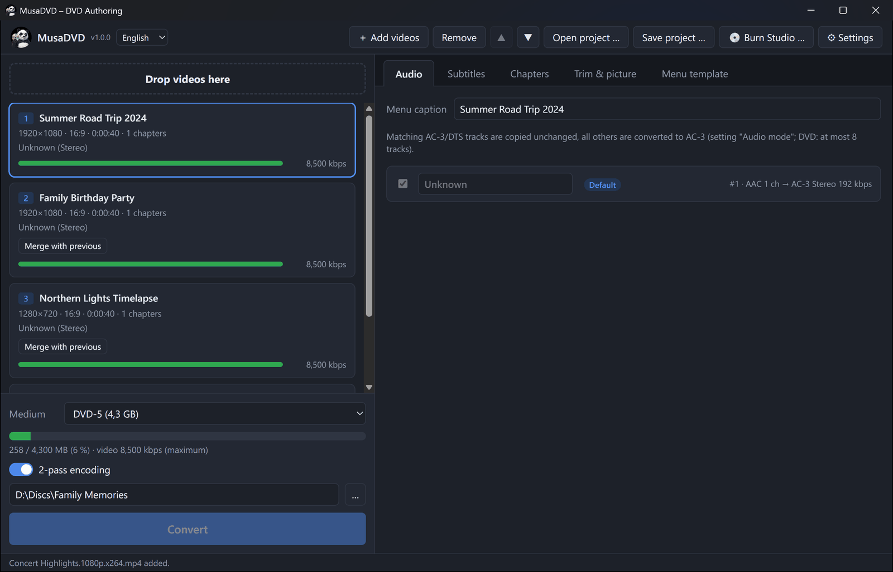
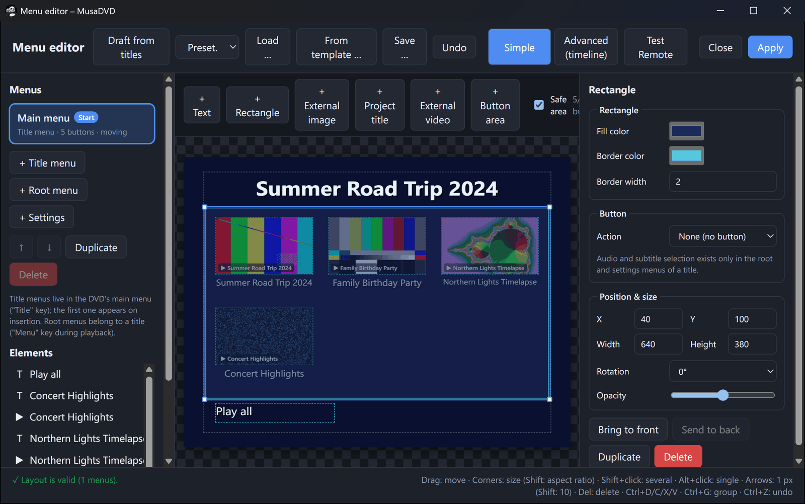
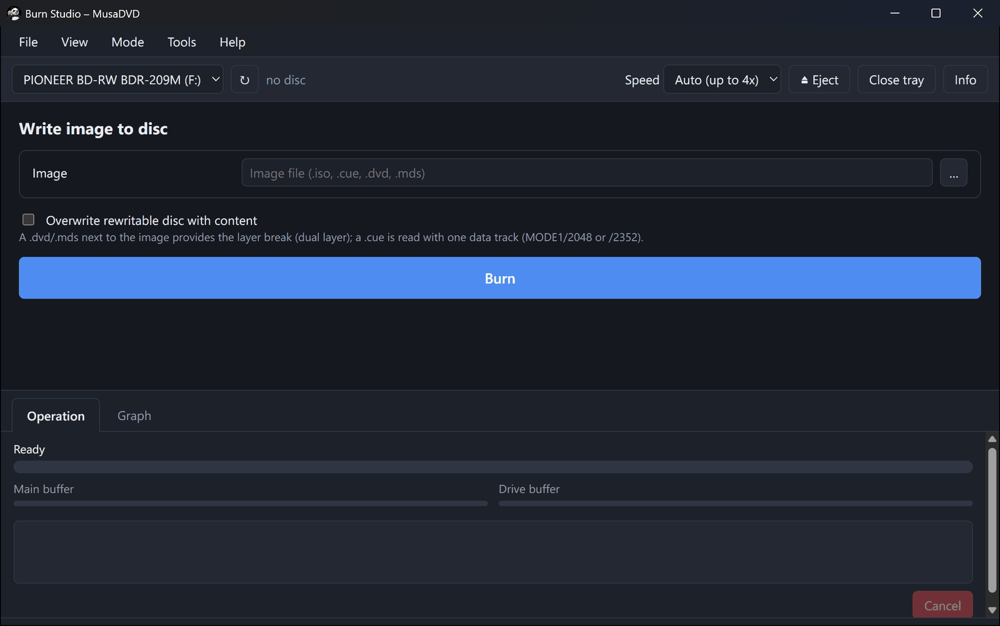
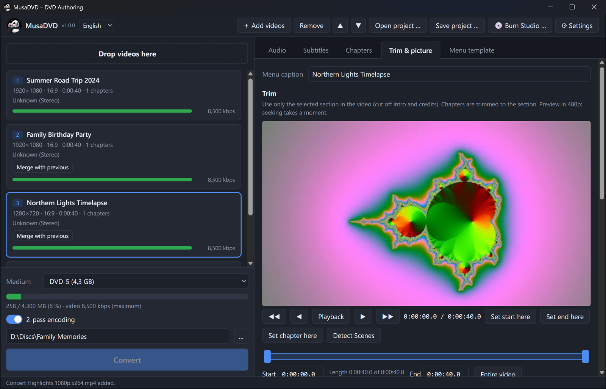

<p align="center">
  
</p>

<h1 align="center">MusaDVD</h1>

<p align="center">
  <b>Drop in your videos, get a real menu-driven DVD, Blu-ray or AVCHD disc.</b><br>
  A clean-room Rust authoring suite with a desktop app, a CLI and its own burning studio.
</p>

<p align="center">
  <a href="https://github.com/islmal/musadvd/releases/latest"></a>
  <a href="LICENSE"></a>
  
  
</p>

MusaDVD turns arbitrary video files (MKV, MP4, AVI, MOV, TS …) into standards-compliant
**DVD-Video** (`VIDEO_TS`), **Blu-ray** or **AVCHD** (`BDMV`), complete with animated menus,
chapters, audio and subtitle selection, and burns them to disc. Everything from the IFO/BDMV
writers to the MPEG/Blu-ray muxers and the UDF image builder is written in Rust; FFmpeg is the
only external tool.

Not affiliated with VSO Software. ConvertX templates are not included; they are only read from a
user's own ConvertXToDVD installation.

## Screenshots

| Main window | Menu editor (Midnight preset) |
| --- | --- |
|  |  |
| **Burn Studio** | **Trim & picture** |
|  |  |

<sub>Screenshots use generated placeholder videos.</sub>

## Highlights

### 🎬 Discs that just work
- **DVD-Video, Blu-ray (BD-25/50) and AVCHD** from the same project, PAL or NTSC.
- **Native authoring stack**: IFO/VOB and BDMV/MPLS/CLPI writers, MPEG-PS and Blu-ray M2TS muxers,
  DVD subpictures and Blu-ray PGS, HDMV menu navigation. No `dvdauthor`, `spumux` or `tsMuxeR`.
- **Verified on real players**: tested in VLC and on a PlayStation 4 (DVD and Blu-ray menus).
- **Exact disc fill**: a bitrate planner splits the disc between titles by duration and a per-title
  quality weight, with a one-click **Fit to disc** and a pre-flight check before anything is encoded.

### ⚡ Smart and fast
- **Smart stream copy**: compliant H.264 and audio go onto Blu-ray/AVCHD untouched, DVD-compliant
  MPEG-2 onto DVD; only what does not fit gets re-encoded. Copied H.264 streams without Blu-ray
  timing get it added automatically (HRD/SEI repair).
- **GPU acceleration**: automatic hardware decoding (`d3d11va`, `cuda`, `qsv`, `vaapi`) and optional
  NVENC / QSV / AMF encoding, plus a faster two-pass MPEG-2 pipeline.
- **10-second quality test**: encode a sample at the planned bitrate and get a PSNR verdict before
  committing to an hour-long build.

### 🎨 Menus you design yourself
- **WYSIWYG menu editor** with drag and resize, a canvas timeline with intro and loop markers,
  motion backgrounds, video thumbnails, rectangles and system fonts.
- **One-click presets with music**: Swiss, Cinema and Midnight restyle every menu and add bundled
  background music; or drop your own sound, image or video straight onto the editor.
- **Test Remote mode**: walk through your menus with the arrow keys or an on-screen D-pad, exactly
  as a disc player will navigate them.
- **ConvertX template import**: reuse your existing ConvertXToDVD themes.
- **Clean captions**: titles derived from file names drop YouTube ids and rip tags
  (`Concert Highlights.1080p.x264` → *Concert Highlights*), and long headings shrink to fit.

### ✂️ Picture and subtitle tools
- Trim, crop (with black-bar detection), denoise and brightness/contrast/saturation with a
  **live preview** that uses the exact same filter chain as the final encode.
- **Scene-change chapters** detected automatically.
- **Subtitles** from text or image sources with styling (font, size, outline, margin) and timing
  offset; Unicode-aware rendering including CJK, right-to-left text and Arabic shaping.

### 💿 Burn Studio
- Read discs to images, build images (UDF 1.02 + ISO 9660 + Joliet), verify and burn, on Windows
  (IMAPI2 or direct SCSI) and Linux (`SG_IO`).
- **Discovery** blank-media tests, write-speed telemetry graphs, layer-break tools for dual-layer
  discs, volume-label and IFO tools.

### 🧰 Built for everyday use
- **Project files** (`.musadvd`) with autosave recovery after a crash.
- **Self-updating**: installer, AppImage and portable builds update in place with a progress
  dialog and SHA-256 verification.
- **One binary, two faces on Linux**: the AppImage and `.deb` also give you the `musadvd` CLI.
- **English, German and Russian** UI, switchable from the header.

## Installation

Prebuilt packages are published automatically on [GitHub Releases](https://github.com/islmal/musadvd/releases) (tagged releases and rolling `nightly` builds). See [CHANGELOG.md](CHANGELOG.md) for release history.

### Windows

- **Installer (recommended):** Download `MusaDVD_<version>_x64-setup.exe` and run it (includes `ffmpeg`/`ffprobe` and auto-updater).
- **Portable:** Download `MusaDVD-<tag>-windows-x64-portable.zip`, extract it, and run `musadvd-gui.exe` or `musadvd.exe`.

### Linux (Ubuntu / Debian / Linux Mint)

1. Download `MusaDVD_<version>_amd64.deb` from Releases and install it:
   ```bash
   sudo apt update
   sudo apt install ./MusaDVD_*_amd64.deb
   ```
2. Allow your user to access optical drives (`/dev/sr0`), then log out and back in:
   ```bash
   sudo usermod -aG cdrom "$USER"
   ```

### Linux (Any Distro — AppImage or Portable)

1. Install runtime dependencies:
   - **Debian/Ubuntu/Mint:** `sudo apt install ffmpeg xorriso dvd+rw-tools`
   - **Fedora:** `sudo dnf install ffmpeg xorriso dvd+rw-tools` *(with RPM Fusion enabled for `ffmpeg`)*
   - **Arch Linux:** `sudo pacman -S ffmpeg libisoburn dvd+rw-tools`
2. Add your user to the optical drive group (`cdrom` on Debian/Ubuntu/Fedora, `optical` on Arch) and re-login.
3. Download either:
   - **`MusaDVD_<version>_amd64.AppImage`:** `chmod +x MusaDVD_*.AppImage && ./MusaDVD_*.AppImage`
   - **`MusaDVD-<tag>-linux-x86_64-portable.tar.gz`:** extract and run `./musadvd-gui` or `./musadvd`.
4. The AppImage is also the CLI: any subcommand, `--cli`, `--help` or `--version` runs the command-line tool instead of the GUI.
   ```bash
   ./MusaDVD_*.AppImage --help
   ln -s "$PWD/MusaDVD_<version>_amd64.AppImage" ~/.local/bin/musadvd   # then just: musadvd --help
   ```
   The self-updater replaces the AppImage in place, so the symlink keeps working.

`xorriso`/`dvd+rw-tools` are only used by the main window's burn step. **Burn Studio** talks to the drive
directly over Linux `SG_IO` (`/dev/srN`, needs the optical drive group from step 2), so it works without them
(not hardware-tested yet).

### Arch Linux (AUR / PKGBUILD)

A ready-to-use PKGBUILD is included at [`packaging/aur/PKGBUILD`](packaging/aur/PKGBUILD):

```bash
cd packaging/aur
makepkg -si
```

## Build from Source

### Windows

Copy `ffmpeg.exe` and `ffprobe.exe` (gyan.dev full build) into `bin/`, then:

```powershell
npm install
npm run build
cargo build --release --bin musadvd
cargo build --release -p musadvd-gui --features tauri/custom-protocol
```

### Linux (Ubuntu 24.04 / Linux Mint 22)

```bash
sudo apt update
sudo apt install -y \
  build-essential curl wget file git patchelf \
  libwebkit2gtk-4.1-dev libgtk-3-dev librsvg2-dev \
  libayatana-appindicator3-dev libssl-dev libxdo-dev \
  ffmpeg xorriso dvd+rw-tools
sudo usermod -aG cdrom "$USER"

npm install
npm run build
cargo build --release --bin musadvd
cargo build --release -p musadvd-gui --features tauri/custom-protocol
```

## CLI

Everything the app does is also available from the command line:

```bash
musadvd build-dvd --help                     # all authoring options
musadvd build-dvd --input "Holiday.mkv" "Party.mp4" --output ./MyDisc
musadvd bitrate --disc dvd5 --duration 7200  # bitrate for a 2 h DVD-5
musadvd drives                               # writers and inserted media
musadvd burn ./MyDisc/VIDEO_TS               # image, write and verify
```

Burn Studio commands: `read-disc`, `verify-disc`, `build-iso`, `iso-label`, `ifo-layerbreak`,
`drive-info`. See [handbook/cli.md](handbook/cli.md) for every option.

## Documentation

- [handbook/](handbook/README.md): architecture, module guides, CLI, settings and testing
- [CHANGELOG.md](CHANGELOG.md): release history

## Licence & credits

GPL-3.0-or-later, see [LICENSE](LICENSE). Derived and bundled components (`dvdauthor`, `tsMuxer`,
DejaVu, FFmpeg): [THIRD_PARTY_NOTICES.md](THIRD_PARTY_NOTICES.md). The menu preset music
("Sunlight on the Floorboards", "Porcelain Hours", "View From The Berth") ships with the app in
`assets/menu-audio/`.
