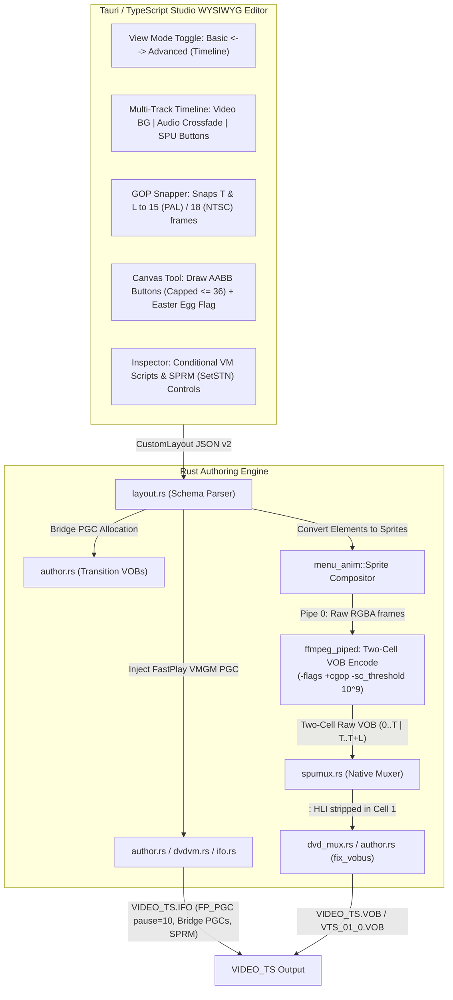

# Implementation Plan: Studio-Grade Disney-Style DVD Authoring
### FastPlay, Multi-Track Timeline, Seamless Motion Intros, Bridge PGCs & Advanced VM Logic

**File Location:** [`docs/plans/2026-11-10-disney-fastplay-and-custom-motion-menus.md`](file:///c:/convertx-rust/docs/plans/2026-11-10-disney-fastplay-and-custom-motion-menus.md)  
**Date:** 2026-11-10  
**Target Architecture:** `convertx-rust` engine ([`src/`](file:///c:/convertx-rust/src/)) & Tauri v2 / Vanilla TypeScript frontend ([`frontend/src/`](file:///c:/convertx-rust/frontend/src/), [`src-tauri/`](file:///c:/convertx-rust/src-tauri/))  
**Design Principles:** Clean-room implementation, strict DVD-Video standard compliance, zero external binary CLI dependencies beyond bundled `ffmpeg`/`ffprobe` (native [`spumux.rs`](file:///c:/convertx-rust/src/spumux.rs), [`dvdvm.rs`](file:///c:/convertx-rust/src/dvdvm.rs), [`dvd_mux.rs`](file:///c:/convertx-rust/src/dvd_mux.rs), and [`ifo.rs`](file:///c:/convertx-rust/src/ifo.rs)).

---

## 1. Executive Summary

The `convertx-rust` backend authoring engine already contains the low-level building blocks required for commercial, studio-grade DVD-Video authoring:
- **Two-Cell Motion Menus:** Frame-accurate intro cell ($0 \le t < T$) transitioning seamlessly into a looping page cell ($T \le t < T+L$) via [`menu_anim::Sprite`](file:///c:/convertx-rust/src/menu_anim.rs), multi-threaded Rayon compositing, and closed MPEG-2 GOP splitting (`-flags +cgop -sc_threshold 1000000000`).
- **Native Subpicture Muxing ([`spumux.rs`](file:///c:/convertx-rust/src/spumux.rs)):** Native subpicture stream generation, 4-color palette CLUT mapping, and optimal $3^N$ button group partitioning ([`pick_groups`](file:///c:/convertx-rust/src/spumux.rs#L535-L543)) capped at 36 buttons per menu.
- **DVD Virtual Machine Compiler ([`dvdvm.rs`](file:///c:/convertx-rust/src/dvdvm.rs)) & IFO Generator ([`ifo.rs`](file:///c:/convertx-rust/src/ifo.rs)):** 8-byte DVD VM bytecode emission, NAV pack VOBU patching ([`fix_vobus`](file:///c:/convertx-rust/src/dvd_mux.rs)), System Parameter Register (`SPRM`) control, and General Parameter Register (`GPRM`) management (`g1..g3`).

However, these capabilities are currently locked behind legacy ConvertX INI/Delphi templates ([`template.rs`](file:///c:/convertx-rust/src/template.rs)). The modern Tauri/TypeScript WYSIWYG editor outputs a [`CustomLayout`](file:///c:/convertx-rust/src/layout.rs#L61-L75) JSON structure, but the backend hardcodes `intro: None` for custom layouts, completely bypassing the two-cell pipeline, FastPlay PGC generation, and transition handling. Furthermore, the frontend lacks a multi-track timeline, GOP-accurate snapping, and fine-grained VM register controls.

This expanded implementation plan establishes the architecture, schema extensions, VM macro generation, and frontend canvas/timeline tooling needed to deliver commercial "Disney-grade" DVD authoring:
1. **Interactive Timeline Editor:** A dual-mode "Basic / Advanced (Timeline)" editor featuring multi-track visualization for video backgrounds, audio crossfades, and button visibility tracks with closed GOP boundary snapping (15 frames PAL, 18 frames NTSC).
2. **Disney FastPlay:** A timed First Play PGC (`FP_PGC` / `pauselen = 10`) that automatically launches Title 1 if unattended, while routing to the VTSM Root Menu / VMGM Main Menu upon user interruption.
3. **Custom Motion Intros & Two-Cell VOB Pipeline:** Seamlessly piping custom intro sprites and video layers into two-cell VOBs, keeping subpicture highlights strictly disabled (`hli_ss == 0`) during Cell 1 ($0 \le t < T$) and active in Cell 2.
4. **Menu-to-Menu Transition Videos (Bridge PGCs):** Standalone video transition PGCs executed upon button press that play a cutscene/wipe animation before jumping to the destination menu.
5. **Hidden Easter Eggs:** 100% transparent subpicture button hotspots with full directional remote navigation.
6. **Conditional VM & SPRM Audio/Subtitle Logic:** Exposing GPRM registers (`g1..g3`, plus user registers `g4..g15`) and System Stream selection commands (`SetSTN`) for dedicated audio/subtitle setup menus.
7. **Continuous Audio Synchronization:** End-to-end audio loop crossfading and sample-accurate PTS alignment via [`DVD_AUDIO_SYNC`](file:///c:/convertx-rust/src/encoder.rs#L395) (`aresample=48000:async=1:min_hard_comp=0.01`).

---

## 2. Architecture & Data Flow Updates



### 2.1 Extending `CustomLayout` JSON Schema ([`src/layout.rs`](file:///c:/convertx-rust/src/layout.rs))

We bump `LAYOUT_VERSION` to `2` with backwards-compatible defaults for version 1 layouts:

```rust
pub const LAYOUT_VERSION: u32 = 2;

#[derive(Debug, Clone, PartialEq, Serialize, Deserialize)]
#[serde(rename_all = "camelCase")]
pub struct CustomLayout {
    #[serde(default = "version_2")]
    pub version: u32,
    #[serde(default)]
    pub canvas: Canvas,
    #[serde(default)]
    pub highlight: Highlight,
    #[serde(default = "yes")]
    pub animations: bool,
    /// Disney-style FastPlay automation configuration.
    #[serde(default, skip_serializing_if = "Option::is_none")]
    pub fast_play: Option<FastPlayConfig>,
    pub menus: Vec<CustomMenu>,
}

#[derive(Debug, Clone, PartialEq, Serialize, Deserialize)]
#[serde(rename_all = "camelCase")]
pub struct FastPlayConfig {
    pub enabled: bool,
    /// Countdown duration in seconds before automatic playback starts (default: 10s).
    #[serde(default = "default_fastplay_timeout")]
    pub timeout_secs: u8,
    /// Target title to play on timeout (defaults to Title 1).
    #[serde(default = "default_title_1")]
    pub target_title: u32,
    /// Destination when remote 'MENU' or on-screen 'Main Menu' is triggered.
    #[serde(default)]
    pub menu_target: FastPlayMenuTarget,
    /// Optional splash/announcement background (still image or short video).
    #[serde(default)]
    pub splash: Option<Background>,
    /// Optional voiceover audio ("FastPlay will begin in a moment...").
    #[serde(default)]
    pub audio: MenuSound,
}

#[derive(Debug, Clone, Copy, PartialEq, Eq, Serialize, Deserialize, Default)]
#[serde(rename_all = "camelCase")]
pub enum FastPlayMenuTarget {
    /// Jump directly to Title 1's Root Menu in VTSM (`jump titleset 1 menu`).
    #[default]
    VtsmRoot,
    /// Jump to the Main Title Menu in VMGM (`jump menu 1` / `jump menu 2`).
    VmgmMain,
}

fn default_fastplay_timeout() -> u8 { 10 }
fn default_title_1() -> u32 { 1 }
fn version_2() -> u32 { LAYOUT_VERSION }
```

#### Menu-to-Menu Transitions & Easter Eggs Schema Extensions
In [`src/layout.rs`](file:///c:/convertx-rust/src/layout.rs) and [`frontend/src/layout.ts`](file:///c:/convertx-rust/frontend/src/layout.ts):

```rust
#[derive(Debug, Clone, PartialEq, Serialize, Deserialize)]
#[serde(tag = "type", rename_all = "camelCase")]
pub enum Action {
    PlayTitle { title: u32 },
    PlayChapter { title: u32, chapter: u32 },
    PlayAll,
    Menu {
        menu: String,
        /// Optional transition video played before entering destination menu.
        #[serde(default, skip_serializing_if = "Option::is_none")]
        transition: Option<TransitionVideo>,
    },
    /// Direct System Stream Selection (SetSTN)
    SetAudio { stream: u8 },
    SetSubtitle { stream: Option<u8> },
    SetAudioAndSubtitle { audio: Option<u8>, subtitle: Option<Option<u8>> },
    /// Custom conditional VM script (e.g. "if (g4 == 1) link button 2; else jump menu 3;")
    CustomVm { script: String },
}

#[derive(Debug, Clone, PartialEq, Serialize, Deserialize)]
#[serde(rename_all = "camelCase")]
pub struct TransitionVideo {
    pub video: VideoAssetSource,
    pub duration_secs: f64,
    #[serde(default)]
    pub audio: MenuSound,
}

#[derive(Debug, Clone, PartialEq, Serialize, Deserialize)]
#[serde(tag = "source", rename_all = "camelCase")]
pub enum VideoAssetSource {
    Title { title: u32, start_secs: Option<f64> },
    File { path: PathBuf, in_point_secs: Option<f64> },
}
```

In [`Element`](file:///c:/convertx-rust/src/layout.rs#L196-L225):
```rust
#[derive(Debug, Clone, PartialEq, Serialize, Deserialize)]
#[serde(rename_all = "camelCase")]
pub struct Element {
    // ... existing fields: id, content, x, y, w, h, rotation, opacity, action, highlight, group, intro ...
    /// Hidden Easter Egg: Button hitbox and navigation active, but subpicture highlight is 100% transparent.
    #[serde(default)]
    pub easter_egg: bool,
}
```

---

### 2.2 Advanced Timeline Editor (Basic / Advanced Toggle)

In [`frontend/src/menuEditor.ts`](file:///c:/convertx-rust/frontend/src/menuEditor.ts):
- **View Toggle:** A segmented header control `[ Einfach | Erweitert (Timeline) ]` toggles between the compact property pane and a full multi-track studio timeline.
- **Multi-Track Visualization (Timeline View):**
  1. **Ruler / Timecode Track:** Formatted in `HH:MM:SS:FF` with scalable zoom (1x to 10x). Displays key markers:
     - Intro Split Marker ($T$): Draggable flag indicating the boundary between Cell 1 and Cell 2.
     - Loop End Marker ($T + L$): Draggable flag indicating the total duration before `jump cell 2;`.
  2. **Video Track:**
     - Displays keyframe thumbnails of the background video asset.
     - Cell 1 ($0..T$) highlighted in soft blue ("Intro Animation").
     - Cell 2 ($T..T+L$) highlighted in green ("Looping Region").
  3. **Audio Track:**
     - Displays waveform preview.
     - Shows the $500\text{ ms}$ crossfade envelope at the loop boundary ($T + L$).
  4. **Subpicture / Button Track:**
     - Each active button displays a horizontal duration bar.
     - For $t < T$, the button track is visually striped and marked `LOCKED (hli_ss == 0)`.
     - For $t \ge T$, the button track turns solid gold, indicating active subpicture navigation.

---

### 2.3 Closed GOP Snapping & Timeline Visibility Synchronization

DVD MPEG-2 constraints dictate that Cell 2 must begin on a closed GOP keyframe with scene detection disabled:
- **PAL ($25.0\text{ fps}$):** 15 frames per GOP $\to$ strict $0.600\text{ s}$ snapping ($0.0\text{ s}, 0.6\text{ s}, 1.2\text{ s}, 1.8\text{ s}, \dots$).
- **NTSC ($29.97\text{ fps}$):** 18 frames per GOP $\to$ strict $0.6006\text{ s}$ snapping ($0.0\text{ s}, 0.6006\text{ s}, 1.2012\text{ s}, \dots$).

#### Snapping Algorithm in `frontend/src/menuEditor.ts`:
```typescript
function snapToClosedGop(secs: number, tv: TvStandard): number {
  const gopSize = tv === "pal" ? 15 : 18;
  const fps = tv === "pal" ? 25.0 : 30000 / 1001;
  const frame = Math.round(secs * fps);
  const snappedFrame = Math.round(frame / gopSize) * gopSize;
  return snappedFrame / fps;
}
```

#### Stage Preview Synchronization:
When scrubbing the timeline playhead:
- If `playheadTime < T`:
  - Canvas buttons are rendered with an opacity of $0.25$, surrounded by a dashed grey border and a badge: `"Subpicture Inaktiv (Cell 1: hli_ss == 0)"`.
  - Mouse interaction on buttons is disabled on the stage.
- If `playheadTime >= T`:
  - Canvas buttons render with full highlight/select styling, demonstrating active subpicture state.

---

### 2.4 Interactive Canvas AABB Drawing Tool & Easter Egg Masking

In [`frontend/src/menuEditor.ts`](file:///c:/convertx-rust/frontend/src/menuEditor.ts) and [`frontend/src/layout.ts`](file:///c:/convertx-rust/frontend/src/layout.ts):

1. **Drawing AABBs:**
   - Dedicated toolbar button: `[+ Button-Bereich]`.
   - Activating entering `"draw-button"` interaction mode (`crosshair` cursor).
   - `onmousedown` records `startX, startY` in canvas storage pixels ($720 \times 576$ PAL / $720 \times 480$ NTSC).
   - `onmousemove` displays a marquee snapped to 2-pixel TV boundaries (`x0 % 2 == 0`, `y0 % 2 == 0`, `x1 % 2 == 1`, `y1 % 2 == 1`).
   - `onmouseup`:
     - Checks minimum dimensions ($16 \times 16\text{ px}$).
     - Validates cap: strictly $\le 36$ buttons ([`MAX_BUTTONS`](file:///c:/convertx-rust/src/author.rs#L36)).
     - Checks collision: overlapping bounding boxes are rejected with error notification (DVD subpictures forbid overlapping buttons).
     - Automatically generates 4-way remote navigation links (`up`, `down`, `left`, `right`) via 90° nearest-neighbor search ([`spumux::default_target`](file:///c:/convertx-rust/src/spumux.rs#L523-L533)).
2. **Easter Egg Mode:**
   - When `element.easter_egg === true`:
     - The WYSIWYG editor marks the box with a secret icon and dotted purple border for the designer.
     - In [`layout::render_custom_page`](file:///c:/convertx-rust/src/layout.rs):
       - The button's geometry is written to `spumux.xml` as a `<button name="..." x0="..." y0="..." x1="..." up="..." down="..." left="..." right="...">`.
       - BUT no pixels are drawn into `highlight.png` or `select.png` (pixel value 0 = 100% transparent).
       - Result: On a physical DVD remote, pressing directional keys lands on the hidden box, but nothing lights up on screen. Pressing Enter immediately triggers the secret action!

---

## 3. Feature Implementation Steps

### Step 1: The FastPlay Macro & First Play Routing

#### DVD VM Navigation Architecture
1. **First Play Program Chain (`FP_PGC`):**
   - Executed on disc insertion in `VIDEO_TS.IFO`.
   - When FastPlay is enabled:
     ```text
     g1 = 0;                   // Reset play-all register
     g2 = 0;                   // Reset titleset dispatch register
     jump menu 1;              // Jump to VMGM Menu PGC 1 (FastPlay PGC)
     ```
2. **The FastPlay Menu PGC (VMGM PGC 1):**
   - Displays FastPlay announcement video or still.
   - Set `pauselen = 10` (stored at byte `163` of the PGC in [`ifo.rs`](file:///c:/convertx-rust/src/ifo.rs#L98)).
   - Buttons:
     - **Button 1 ("FastPlay Now"):** `g1 = 0; jump title 1;`
     - **Button 2 ("Main Menu"):** `g1 = 0; jump menu 2;` (or `jump titleset 1 menu;` if `VtsmRoot`).
   - Post Command:
     ```text
     jump title 1;
     ```
   - User Operations (`PUO`): All 32 bits set to `0` (unprohibited), ensuring remote Menu/Title buttons interrupt the pause immediately.

---

### Step 2: Motion Intros for Custom Menus (Two-Cell VOB Pipeline)

#### 1. Frame Budgeting & GOP Alignment
- Let $T_{\text{raw}}$ be `menu.intro_secs` and $L$ be `menu.duration_secs`.
- Frame count calculation:
  $$F_{\text{intro}} = \left\lceil \frac{T_{\text{raw}} \cdot \text{fps}}{\text{gop\_size}} \right\rceil \cdot \text{gop\_size}, \quad T = \frac{F_{\text{intro}}}{\text{fps}}$$
- Total video duration: $T + L$.

#### 2. Sprite Compositing Pipeline in [`src/layout.rs`](file:///c:/convertx-rust/src/layout.rs)
- Elements with keyframes are converted to [`menu_anim::Sprite`](file:///c:/convertx-rust/src/menu_anim.rs) objects (`Pixels::Image`).
- Video element slots become `Pixels::Slot { index, width, height }`.
- Set `files.intro = Some(intro)`.

#### 3. Two-Cell MPEG-2 Encoding in [`src/dvd.rs`](file:///c:/convertx-rust/src/dvd.rs)
- Remove the template-only restriction in `src/dvd.rs` step 5.
- Invoke `tools.ffmpeg_piped` passing `menu_anim::composite_frame`.
- Apply closed GOP encoding flags:
  `-force_key_frames expr:gte(t,{T}) -flags +cgop -sc_threshold 1000000000`
- Menu PGC in [`src/author.rs`](file:///c:/convertx-rust/src/author.rs):
  ```xml
  <vob file="custom_menu.mpg">
    <cell start="0" end="{T:.3}" program="1"/>
    <cell start="{T:.3}"/>
  </vob>
  <post>jump cell 2;</post>
  ```
- Subpicture activation: `<spu start="{spu_time(T)}" ...>` in `spumux.xml`.
- In [`dvd_mux::fix_vobus`](file:///c:/convertx-rust/src/dvd_mux.rs), enforce `hli_ss == 0` for all Cell 1 VOBUs ($0 \le \text{PTS} < T$) and active HLI in Cell 2.

---

### Step 3: Menu-to-Menu Transition Videos (Bridge PGCs)

When a button in Menu A navigates to Menu B with a transition video:
1. **Bridge PGC Generation ([`src/author.rs`](file:///c:/convertx-rust/src/author.rs)):**
   - The engine generates a standalone command-and-video PGC (a Bridge PGC) in the appropriate domain (VMGM or VTSM).
   - The Bridge PGC contains:
     - One single video cell playing the transition video asset (`transition.mpg`).
     - No buttons (`buttons: vec![]`).
     - `pauselen = 0`.
     - `<post>` command: `jump menu <destination_menu_pgc>;`.
2. **Button Command Rewiring:**
   - The button on Menu A compiles to:
     ```text
     jump menu <bridge_pgc_number>;
     ```
   - If the transition crosses domains (e.g. VTSM Root Menu $\to$ VMGM Title Menu), the button command routes through the VMGM router register (`g3 = 2000 + dest; call vmgm menu <bridge_pgc>;`).

---

### Step 4: Hidden Easter Eggs (Transparent Subpicture Navigation)

1. **Subpicture Mask Generation ([`src/layout.rs`](file:///c:/convertx-rust/src/layout.rs)):**
   - In `render_custom_page`, when `element.easter_egg == true`:
     - Skip drawing highlight and select bounding rectangles into `highlight.png` and `select.png` (or draw with transparent palette index 0).
2. **Navigation Insertion ([`src/spumux.rs`](file:///c:/convertx-rust/src/spumux.rs)):**
   - The button entry is included in `spumux.xml`:
     ```xml
     <button name="egg1" x0="610" y0="40" x1="680" y1="100" left="btn_play" down="btn_scenes"/>
     ```
   - Surrounding buttons link to `"egg1"` when pressing remote `Up` or `Right`.
   - On the disc, navigating to `egg1` shows no highlight, but pressing `ENTER` executes its action (e.g. `jump title 3;` or `jump menu 5;`).

---

### Step 5: Conditional VM Logic & Register Allocation (`g0..g15`)

1. **Register Map Architecture:**
   - `g1`: Engine play-all flag (`g1 = 1` = sequential playback).
   - `g2`: Titleset entry dispatcher register (`1..=99` = chapter, `100+j` = j-th root menu).
   - `g3`: VMGM router code (`1000+t` = play title t, `2000+t` = enter titleset t).
   - **`g4..g15` (User Registers):** Completely unreserved and exposed for custom conditional logic!
2. **Script Compilation in [`src/dvdvm.rs`](file:///c:/convertx-rust/src/dvdvm.rs):**
   - The UI lets users input conditional statements:
     ```text
     if (g4 == 1) link button 2; else jump menu 3;
     ```
   - [`dvdvm::compile_str`](file:///c:/convertx-rust/src/dvdvm.rs#L1039) compiles conditions, arithmetic (`g4 += 1;`), register comparisons, and `LinkBtn` (`Link(16)` with button number $\cdot 1024$) into native 8-byte DVD instructions.

---

### Step 6: System Register (SPRM) Audio & Subtitle Selection (`SetSTN`)

Dedicated Audio/Subtitle Setup menus require changing the active language stream without starting title playback:
1. **DVD VM Bytecode ([`src/dvdvm.rs`](file:///c:/convertx-rust/src/dvdvm.rs)):**
   - Setting audio track: `audio = N;` (where $N$ is 0-based stream index).
   - Setting subtitle track: `subtitle = 64 + N;` (bit 6 = 1 enables display; `subtitle = 0;` disables subtitles).
2. **Automatic SetSTN Merging:**
   - In [`dvdvm.rs:974`](file:///c:/convertx-rust/src/dvdvm.rs#L974), the compiler detects consecutive `SetSTN` operations:
     ```text
     audio = 1; subtitle = 64;
     ```
     And merges them into a single 8-byte instruction:
     `51000081c0000000`
3. **UI Setup Menu Builder:**
   - In `menuEditor.ts`, setting a button action to `SetAudio` or `SetSubtitle` configures the button command as:
     ```text
     audio = {track_idx};
     ```
     Followed by an optional `link button {self_idx};` to keep focus on the selected button.

---

### Step 7: Continuous Audio Sync (`DVD_AUDIO_SYNC`)

In [`src/encoder.rs`](file:///c:/convertx-rust/src/encoder.rs):
```rust
pub const DVD_AUDIO_SYNC: &str = "aresample=48000:async=1:min_hard_comp=0.01";
```
1. **Intro + Loop Construction:**
   - Intro audio runs across $[0, T]$.
   - Loop audio runs across $[T, T + L]$.
   - At the loop wrap-around point ($T + L$), a $500\text{ ms}$ crossfade is applied using ffmpeg's `acrossfade=d=0.5:c1=tri:c2=tri`.
2. **Filter Graph Injection:**
   ```text
   [a_src] atrim=0:{T+L}, aresample=48000:async=1:min_hard_comp=0.01, acopy [a_out]
   ```
   - Resamples and hard-compensates audio timing so the sample count matches the exact video frame duration.
   - Guarantees that when the player loops back via `jump cell 2;`, audio PTS seamlessly aligns with the video PTS at $T$ without drift or audio glitching.

---

## 4. Implementation Schedule & File Roadmap

| Phase | Target Files | Key Tasks |
| :--- | :--- | :--- |
| **Phase 1: Model & Schema** | [`src/layout.rs`](file:///c:/convertx-rust/src/layout.rs)<br>[`frontend/src/layout.ts`](file:///c:/convertx-rust/frontend/src/layout.ts) | Bump to `LAYOUT_VERSION = 2`. Add `FastPlayConfig`, `TransitionVideo`, `easter_egg: bool`, `SetAudio`/`SetSubtitle` actions, and `CustomVm` action. |
| **Phase 2: FastPlay & Bridge PGCs** | [`src/author.rs`](file:///c:/convertx-rust/src/author.rs)<br>[`src/dvdvm.rs`](file:///c:/convertx-rust/src/dvdvm.rs)<br>[`src/ifo.rs`](file:///c:/convertx-rust/src/ifo.rs) | Inject VMGM FastPlay Menu PGC (`pauselen = 10`, post `jump title 1;`). Allocate Bridge PGCs for transition videos with post jump to destination menu. |
| **Phase 3: Two-Cell Compositor** | [`src/layout.rs`](file:///c:/convertx-rust/src/layout.rs)<br>[`src/dvd.rs`](file:///c:/convertx-rust/src/dvd.rs)<br>[`src/encoder.rs`](file:///c:/convertx-rust/src/encoder.rs) | Map `CustomLayout` intro elements to `menu_anim::Sprite`. Update `dvd.rs` step 5 to pipe intro frames through `menu_anim::composite_frame`. Add `-flags +cgop -sc_threshold 1000000000`. |
| **Phase 4: Easter Egg Masks & SPRM** | [`src/layout.rs`](file:///c:/convertx-rust/src/layout.rs)<br>[`src/spumux.rs`](file:///c:/convertx-rust/src/spumux.rs) | Omit subpicture palette drawing for `easter_egg` buttons while preserving XML navigation coordinates. Implement `SetSTN` action compilation. |
| **Phase 5: Advanced Timeline UI** | [`frontend/src/menuEditor.ts`](file:///c:/convertx-rust/frontend/src/menuEditor.ts)<br>[`frontend/src/styles.css`](file:///c:/convertx-rust/frontend/src/styles.css) | Implement Basic/Advanced toggle, multi-track timeline, GOP-accurate marker snapping (15/18 frames), timeline stage lock, and Easter Egg inspector toggle. |
| **Phase 6: Verification & QA** | [`tests/`](file:///c:/convertx-rust/tests/) | Add tests for FastPlay VM routing, Bridge PGC transitions, Easter Egg transparent masks, SetSTN bytecode, and closed GOP NAV packs. |

---

## 5. Testing & QA Strategy

### 5.1 DVD VM Routing & FastPlay Unit Tests (`tests/fastplay_vm.rs`)
- **FastPlay Enabled:**
  - Verify that `VIDEO_TS.IFO` contains `FP_PGC` routing to VMGM PGC 1.
  - Assert that VMGM PGC 1 byte at offset `163` (`pauselen`) equals `10`.
  - Assert Button 1 command compiles to `g1 = 0; jump title 1;`.
  - Assert Button 2 command compiles to `g1 = 0; jump titleset 1 menu;` (or `jump menu 2;`).
  - Assert `<post>` command compiles to `jump title 1;`.
- **FastPlay Disabled:**
  - Verify backwards compatibility: disc insertion jumps directly to `menu 1` (or `title 1` if `auto_start` is enabled).

### 5.2 Bridge PGC & Transition Video Tests (`tests/menu_transitions.rs`)
- Create a test project with Menu 1 linking to Menu 2 via a 2.0s transition video.
- Build the DVD and inspect the authored PGC set:
  - Assert that Menu 1 Button 1 jumps to the Bridge PGC (`jump menu 3;`).
  - Assert that the Bridge PGC contains `transition.mpg` with `pauselen == 0` and no buttons.
  - Assert that the Bridge PGC `<post>` command executes `jump menu 2;`.

### 5.3 Closed GOP & Two-Cell NAV Pack Inspection (`tests/custom_menu_intro.rs`)
Following the pattern in [`tests/menu_intro.rs`](file:///c:/convertx-rust/tests/):
- Author a 2-cell custom DVD menu (PAL and NTSC).
- Parse the output menu VOB:
  1. **Cell Boundaries:** Verify Cell 1 runs $[0, T]$ and Cell 2 runs $[T, T+L]$.
  2. **GOP Closure:** Verify `firstifield == 0` at PTS $T$ via `dvd_mux::mark_chapters`, confirming no `GOP may not be closed` warnings appear in `authoring.log`.
  3. **NAV Pack HLI Verification:**
     - Scan all VOBU NAV sectors (`0x26..0x2A == 00 00 01 BF`, substream `0x2C == 0x00`).
     - Check `hli_ss` at byte offset `0x8D`:
       - For all VOBUs with $\text{PTS} < T$: assert `hli_ss == 0` (buttons disabled during intro).
       - For all VOBUs with $\text{PTS} \ge T$: assert `hli_ss != 0` (buttons active during loop).

### 5.4 Easter Egg & Subpicture Transparency Verification (`tests/spumux_easter_egg.rs`)
- Author a menu containing 1 normal button and 1 Easter Egg button.
- Check generated `highlight.png` and `select.png`:
  - Assert that the bounding box region of the Easter Egg button contains only pixel index 0 (transparent).
- Check `spumux.xml` and authoring output:
  - Assert that the Easter Egg button exists in the subpicture stream with valid remote navigation coordinates linking to the normal button.

### 5.5 SPRM / SetSTN Bytecode Verification (`tests/dvdvm_sprm.rs`)
- In `tests/dvdvm_sprm.rs`:
  - Compile `audio = 2; subtitle = 65;`.
  - Assert that the compiled instruction vector contains exactly one 8-byte instruction matching `51000082c1000000` (SetSTN with merged audio stream 2 and active subtitle stream 1).

### 5.6 Player & Hardware Verification
1. **Software Players (VLC 3.0.x & mpv):**
   - Confirm FastPlay countdown timer triggers Title 1 playback after 10 seconds.
   - Confirm pressing Remote Menu during the 10-second window breaks out to the Root Menu.
   - Confirm menu transition videos play smoothly before displaying destination menus.
   - Confirm navigating to hidden Easter Egg spots triggers the hidden action on Enter without showing bounding box artifacts.
   - Confirm looping Cell 2 executes seamlessly without audio clicks or video pauses.
2. **Consumer Standalone Hardware:**
   - Burn a DVD-R via [`burner::burn_video_ts`](file:///c:/convertx-rust/src/burner/) and verify seamless playback on standalone consumer players (Sony / Panasonic / Samsung).
